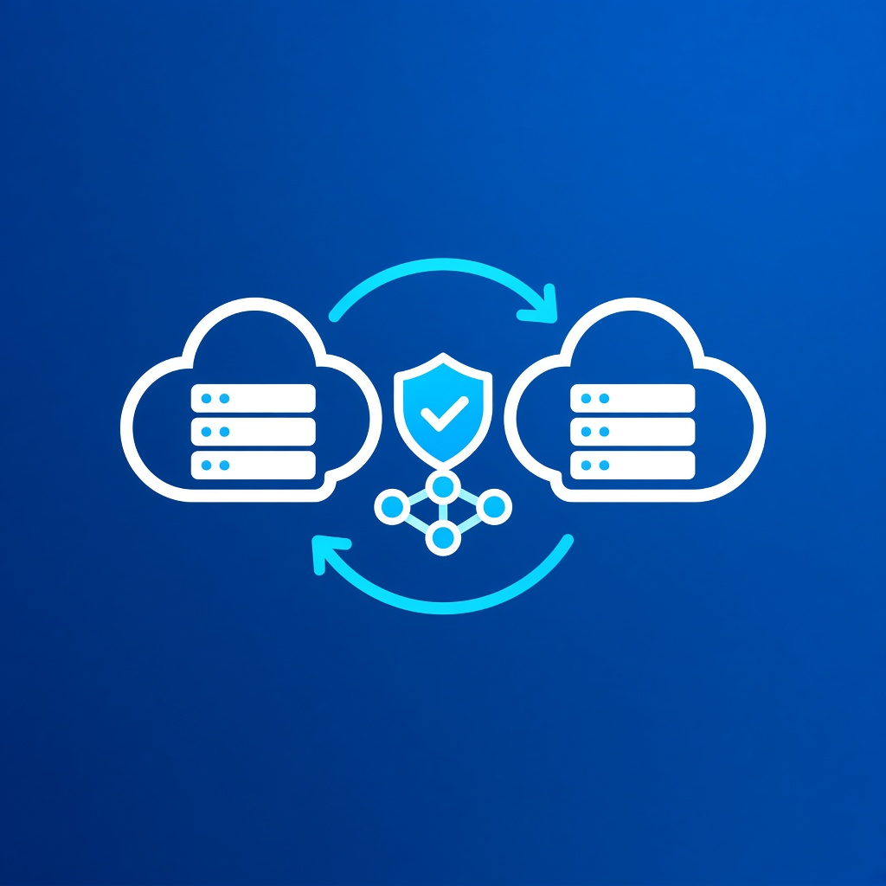
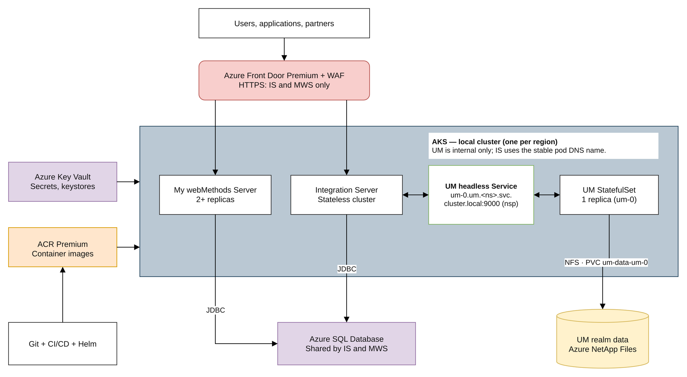
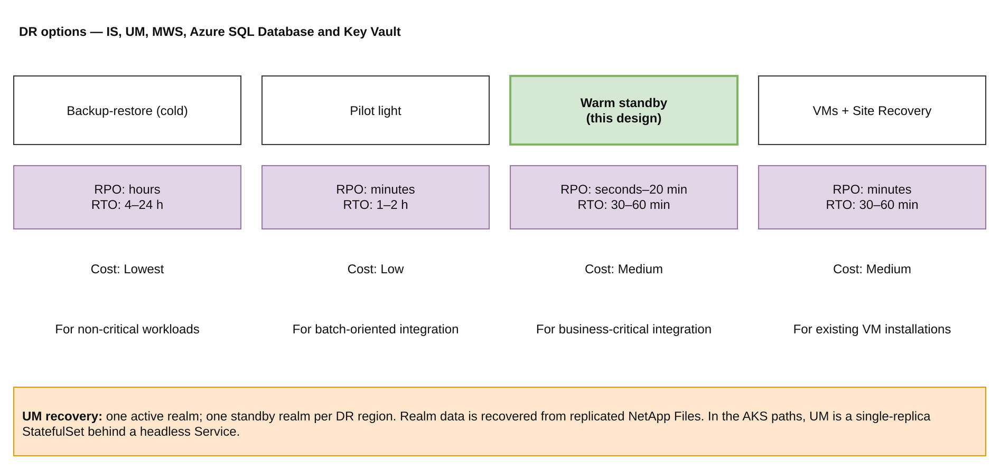
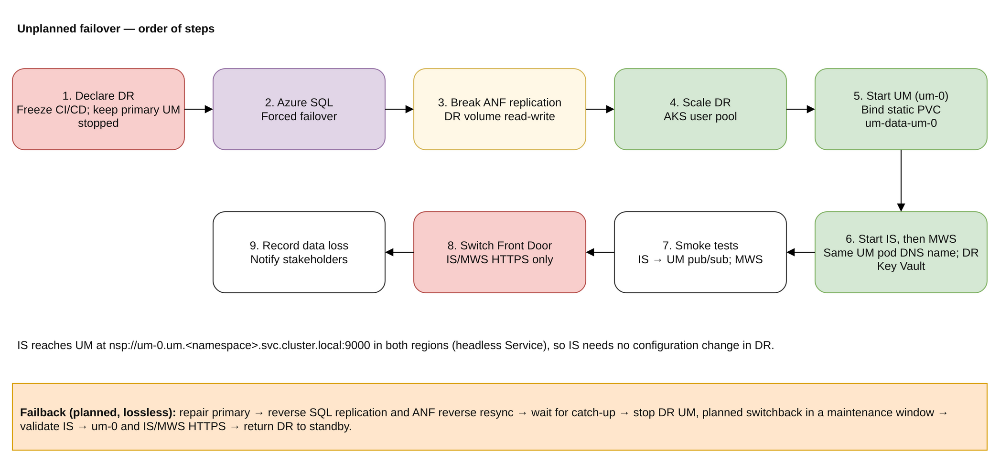

# webMethods 12.1 on Azure – DR Solution Design

## 1. Overview

This design protects an IBM webMethods 12.1 platform on Azure against the loss of a whole Azure region. Scope: Integration Server (IS), Universal Messaging (UM), My webMethods Server (MWS), Azure SQL Database and Azure Key Vault, plus the Azure infrastructure they need.

High availability (HA) for IS and MWS comes from replicas spread across availability zones. UM runs as one active realm; a pod restart or reschedule recovers it from its persistent volume. Disaster recovery (DR) across regions comes from a **warm standby**: a pre-built second environment that is kept in sync and switched on when needed.

## 2. Executive summary

- **Pattern:** active-passive warm standby on AKS in two regions. Everything in DR exists and is configured; only the compute is scaled down.
- **Data:** IS and MWS state is in Azure SQL Database, replicated by an auto-failover group. The UM realm data is on Azure NetApp Files with cross-region replication. Secrets are in one Key Vault per region.
- **Traffic:** Azure Front Door handles HTTPS for IS services and the MWS UI only. UM has no external clients: IS connects to UM in the same AKS cluster using the stable pod DNS name `nsp://um-0.um.webmethods.svc.cluster.local:9000`.
- **Targets:** RTO 30–60 min. RPO is seconds for the database and up to about 20 min for UM. Both are proven only by drills.
- **Cost:** storage and database in both regions, plus a small always-on AKS footprint. DR compute is paid only during drills and real events.

## 3. Components in plain terms

### webMethods (IBM docs, version 12.1)

| Component | What it does | What must survive a disaster | Source |
|---|---|---|---|
| Integration Server (IS) | Runs integration services: flows, adapters, schedulers. Packages are built into the container image. | Shared database components: ISCoreAudit, ISInternal, DistributedLocking, cross-reference, document history. | [IS clustering overview](https://www.ibm.com/docs/en/webmethods-integration/wm-integration-server/12.1.0?topic=guide-overview-clustering) |
| Universal Messaging (UM) | Message broker (pub/sub, queues). IS triggers use it inside AKS. | The realm data directory: channels, queues, stored events. | [UM active/passive](https://www.ibm.com/docs/en/webmethods-integration/wm-universal-messaging/12.1.0?topic=clustering-about-activepassive) |
| My webMethods Server (MWS) | Web UI for administration, monitoring and tasks. Its cluster configuration is stored in its database. | MWS database, plus `cluster.xml` supplied through a mounted volume. | [MWS 12.1 container config](https://www.ibm.com/docs/en/webmethods-integration/wm-my-webmethods-server/12.1.0?topic=container-configuration-examples) |

Database requirements (confirmed in the 12.1 installer docs): SQL Server is a supported RDBMS. It needs an 8K page size ([Page and Block Size](https://www.ibm.com/docs/en/webmethods-integration/webmethods-installer/12.1.0?topic=rdbmss-page-block-size)), and IS and MWS do not support case-sensitive collations ([Set Database Options](https://www.ibm.com/docs/en/webmethods-integration/webmethods-installer/12.1.0?topic=rdbmss-set-database-options)). Azure SQL Database is supported as the database for webMethods 12.1 IS and MWS running on AKS.

### Azure services and why each is needed

| Service | Supports | Role |
|---|---|---|
| Azure SQL Database + auto-failover group | IS, MWS | Shared database. The listener name follows the primary, so connection strings are the same in both regions. |
| Azure Key Vault (one per region) | IS, UM, MWS | DB credentials, keystores/truststores, licence keys. Both vaults are written by the pipeline. |
| AKS | IS, UM, MWS | Runs the containers, with zone-spread pools where available. UM runs as a single-replica StatefulSet behind a headless Service, giving IS a stable per-pod DNS name. |
| AKS scale-down mode `Deallocate` | IS, UM, MWS | Keeps DR nodes stopped (not deleted) so their image cache survives and they start quickly. |
| Azure Container Registry Premium (geo-replicated) | IS, UM, MWS | Serves the same image name in both regions. |
| Azure NetApp Files + cross-region replication | UM | NFS volume for the UM realm data, replicated to DR. |
| Azure Front Door Premium + WAF | IS HTTPS endpoints, MWS UI | Global HTTPS entry with health probes and Private Link to the internal origins. |
| Private endpoints + Private DNS | Azure SQL Database, Key Vault, ACR | Private access that resolves correctly in both regions. |
| VNet hub-spoke + global peering | All | Private connectivity between the regions for replication and operations. |
| Azure Monitor / Automation | All | Alerting and scripted runbook steps. |

Each capability and its Microsoft doc link is in `azure-service-validation.xlsx`.

## 4. Design choices and rationale

| # | Decision | Rationale | Trade-off |
|---|---|---|---|
| D1 | Warm standby, active-passive | Best RTO/cost balance for a messaging-centred platform with a single-writer database. | DR compute is proven only in drills. |
| D2 | IS runs as a **stateless** cluster: all nodes share the Azure SQL database | No in-memory state to replicate or fail over, so any node in either region can take over from the shared database; fewer moving parts to run and recover. | IS services should be designed to be stateless per request. |
| D3 | One Azure SQL Database server per region, linked by an auto-failover group | Managed asynchronous geo-replication with one listener endpoint for IS and MWS. | A forced failover can lose the last seconds of commits. |
| D4 | UM: one realm per region, active/passive, as a single-replica StatefulSet (`um`) on ANF with cross-region replication | The StatefulSet keeps exactly one pod (`um-0`) bound to the UM data volume. A single active realm keeps messaging local to the serving region. | RPO depends on the age of the last completed ANF transfer; in-flight events may be lost or duplicated. |
| D5 | DR volume handling for UM | (a) The DR ANF volume is read-only while replication runs; breaking replication at failover makes it read-write. (b) In DR, a statically pre-created PV and PVC point at the DR ANF volume. The PVC is named to match the StatefulSet claim, `<template>-um-0` (for example `um-data-um-0`), so the pod binds to it rather than to a new dynamically provisioned volume. (c) Single writer: primary UM is kept stopped once DR is active. (d) Failback is a reverse resync of the ANF volume, then a planned switchback. | The static PV/PVC must be kept in Git and checked in every drill. |
| D6 | MWS: two or more replicas, configuration in the DB, `cluster.xml` from a ConfigMap/volume | IBM: container clusters load `cluster.xml` from the mounted config volume into the database. | The front-end URL must be the global (Front Door) hostname. |
| D7 | Deployment by image. CI builds IS packages into images and applies identical Helm values to both regions from Git. | The regions are identical by construction; a DR start is a scale-up, not a deployment. | Changes made outside Git cause drift; forbid them. |
| D8 | Front Door for IS/MWS HTTPS only; UM behind a headless Service, reached by stable pod DNS name | Pod IPs change on restart, so IS needs a stable name. The headless Service gives the pod a per-pod DNS name with no virtual IP. IS connects to `nsp://um-0.um.webmethods.svc.cluster.local:9000`; the name is identical in both regions, so IS needs no configuration change in DR. | Validate CoreDNS, the headless Service and NetworkPolicy in both clusters. There is no global DNS switch for UM. |
| D9 | Two Key Vaults, written by the pipeline | Each region is self-contained. Key Vault backups restore only within the same subscription and geography. | The pipeline is the source of truth for secrets. |
| D10 | DR user node pool at minimum size with `Deallocate` | Cached images give a fast start; you pay only for disks while the nodes are stopped. | Needs managed OS disks; not supported with ephemeral OS disks or Spot. |

## 5. RPO / RTO targets

**Recovery Time Objective (RTO)** is the target maximum time to restore a usable business service after an outage. A 60-minute RTO means the service should be usable within one hour, including the DR decision, recovery steps and validation.

**Recovery Point Objective (RPO)** is the target maximum amount of recent data that could be lost, measured in time before the outage. A 20-minute RPO means recovery may lose up to the last 20 minutes of changes; it does not mean recovery takes 20 minutes.

These are planning targets, not guarantees. Recovery tests must measure both elapsed outage time and the actual recovered data point.

| Component | RPO (unplanned) | RTO | Driven by |
|---|---|---|---|
| Azure SQL Database (IS, MWS) | seconds (async) | 5–15 min | Forced failover of the failover group |
| UM (ANF, active/passive) | ≤ 20 min (10-min schedule plus transfer) | 20–40 min | ANF break, UM pod bound to the static PVC and ready |
| Integration Server | = DB (plus UM for trigger documents) | 15–30 min | Node start, pod scale, reconnection to `um-0` pod DNS name |
| MWS | = DB | 20–30 min | Pod start |
| Key Vault | 0 (pipeline-synced) | 0 | Already in place |
| **Platform** | **≤ 20 min worst case** | **30–60 min** | |

Planned switchovers (drills, failback) lose no data: stop writers, let replication catch up, then switch.

## 6. Alternative DR paths

| Path | RPO / RTO | Relative cost | Complexity | Choose when |
|---|---|---|---|---|
| Backup-restore (cold): Azure Backup for AKS with cross-region restore, SQL geo-restore, IaC rebuild | hours / 4–24 h | Lowest | Low–medium | Non-critical workloads, tight budget |
| Pilot light: SQL and ANF replicate; AKS control plane only | minutes / 1–2 h | Low | Medium | Batch-oriented integrations that tolerate an hour or more of outage |
| **Warm standby (this design)** | seconds–20 min / 30–60 min | Medium | Medium | Business-critical, near-real-time integration |
| IaaS VMs + Azure Site Recovery | crash-consistent minutes / 30–60 min | Medium | Low for existing VM installs | IS/UM/MWS are not containerised yet |

Choose between cold, pilot light and warm standby using measured rebuild time, message volume and business outage tolerance. Use the VM path where container adoption is not ready.

## 7. Failover and failback outline

**Failover (unplanned)**
1. A human declares DR, using Azure Monitor alerts. Freeze CI/CD. Keep primary UM stopped from now on (single writer).
2. Azure SQL: force failover of the failover group. The listener now points to DR.
3. ANF: break replication on the DR UM volume. It is read-only while replication runs; after the break it is read-write.
4. AKS: scale the DR user pool to production size.
5. UM: confirm the pre-created static PV and PVC (`um-data-um-0`) are bound to the DR ANF volume, then scale the StatefulSet to 1. Check that `um-0` mounts that claim (not a new dynamic volume) and that the realm and channels are present.
6. Scale IS, then MWS, using the DR Key Vault. IS uses the same UM URL as in the primary region (`nsp://um-0.um.webmethods.svc.cluster.local:9000`); verify it resolves to the DR pod and reconnects. No configuration change.
7. Smoke tests: IS health, IS-to-UM publish/subscribe to `um-0`, a sample IS service, and MWS login.
8. Switch the Front Door origin for IS/MWS HTTPS only. Verify Private DNS for SQL, Key Vault and ACR; UM resolution remains local to DR AKS.
9. Record the data-loss window (SQL lag, last ANF transfer). Inform stakeholders.

**Failback (planned)**
1. Repair the primary from IaC and Helm.
2. Reverse replication: the failover group swaps roles; ANF reverse-resyncs the UM volume from DR to the primary.
3. Wait for catch-up, then do a planned switchback in a maintenance window: stop DR UM, complete the final resync, start primary UM on its volume.
4. Confirm IS in the primary cluster connects to `um-0` in its own cluster and validate IS/MWS through Front Door. Return DR to standby: stop its workloads and replicate primary → DR again.

Drill at least twice a year. A target counts only once it has been measured.

## 8. Risks

- Async replication means RPO > 0. IS trigger consumers must be idempotent, because UM documents can be replayed or duplicated.
- Two UM writers on the same realm data would corrupt it. Primary UM stays stopped once DR is active, until the planned switchback.
- If the DR PVC name does not match the StatefulSet claim, the pod gets a new empty volume. Check the binding in every drill.
- Configuration drift between regions. Mitigation: Git-only changes and drift checks.
- Cost of ANF capacity pools in two regions; minimum pool sizes apply.
