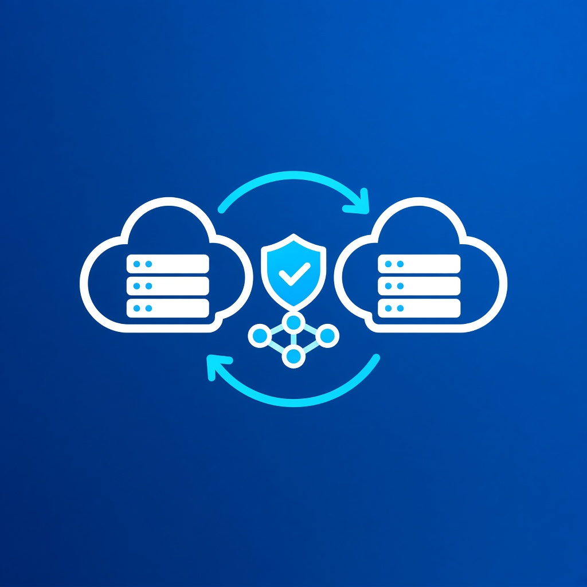
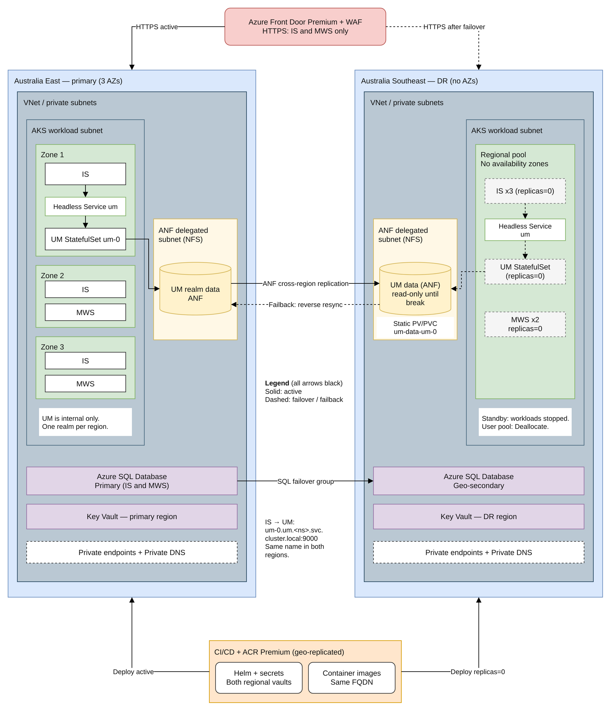

# Region variant A – Australia

Primary: **Australia East** (New South Wales, 3 availability zones). DR: **Australia Southeast** (Victoria, **no availability zones**). The two regions are an Azure region pair. Source: [Azure regions list](https://learn.microsoft.com/en-us/azure/reliability/regions-list).

## What is specific to this variant

| Area | Australia East (primary) | Australia Southeast (DR) |
|---|---|---|
| AKS node pools | Zone-spread across 1/2/3, with topology spread constraints | Regional (no zones). All pods sit in one datacenter. |
| Azure SQL Database | Zone-redundant | Geo-secondary (not zone-redundant: no zones) |
| Azure NetApp Files | Source volumes | Replication destination (this region pair is supported for ANF replication: [ANF replication](https://learn.microsoft.com/en-us/azure/azure-netapp-files/replication)) |
| Key Vault | Regional vault | Regional vault. Backup/restore is allowed because both regions are in the Australia geography ([Key Vault reliability](https://learn.microsoft.com/en-us/azure/reliability/reliability-key-vault)) |
| IS / MWS HA | Replicas spread across zones | Same replica count, single datacenter |
| UM | StatefulSet `um` (1 replica) behind a headless Service; volume on ANF | StatefulSet at 0 replicas; static PV/PVC `um-data-um-0` on the DR ANF volume (read-only until replication is broken) |

## Consequences

IS connects to UM only within the local AKS cluster, using `nsp://um-0.um.webmethods.svc.cluster.local:9000` in both regions. Front Door serves IS/MWS HTTPS only.

UM DR volume handling: break ANF replication at failover so the DR volume becomes read-write; the pre-created PVC `um-data-um-0` binds `um-0` to it; primary UM stays stopped while DR is active; failback is an ANF reverse resync followed by a planned switchback.

- While running in DR, the platform has **no protection against a datacenter failure**. That is acceptable for a short DR period. Size the DR stay to hours or days, not months.
- Paired-region benefits apply, such as sequenced platform updates and Microsoft-managed Key Vault replication. Microsoft-managed failover is best-effort and is not part of the RTO.
- Australia Central and Central 2 (Canberra) also have no zones. They are an option only for workloads that need those regions for compliance.

## New Zealand North option

New Zealand North (Auckland) has **3 availability zones and no paired region** ([regions list](https://learn.microsoft.com/en-us/azure/reliability/regions-list)). Using it as the DR region gives zone-redundant DR, at these costs:

- Data leaves Australia. Check data-residency and regulatory constraints (for example APRA-regulated workloads) first.
- Services that replicate only to the paired region do not help. These include GRS storage and AKS Backup cross-region restore (paired region only: [AKS backup across regions](https://learn.microsoft.com/en-us/azure/backup/tutorial-restore-aks-backups-across-regions)). This design does not depend on them: SQL failover groups and ANF replication target any supported region.
- **Not verified:** that ANF cross-region replication supports Australia East → New Zealand North. Check the ANF supported pairs list before choosing.
- Measure replication lag and transfer duration for the chosen pair against the UM RPO target.

Choose New Zealand North when zone resilience during DR matters more than keeping data in Australia.
