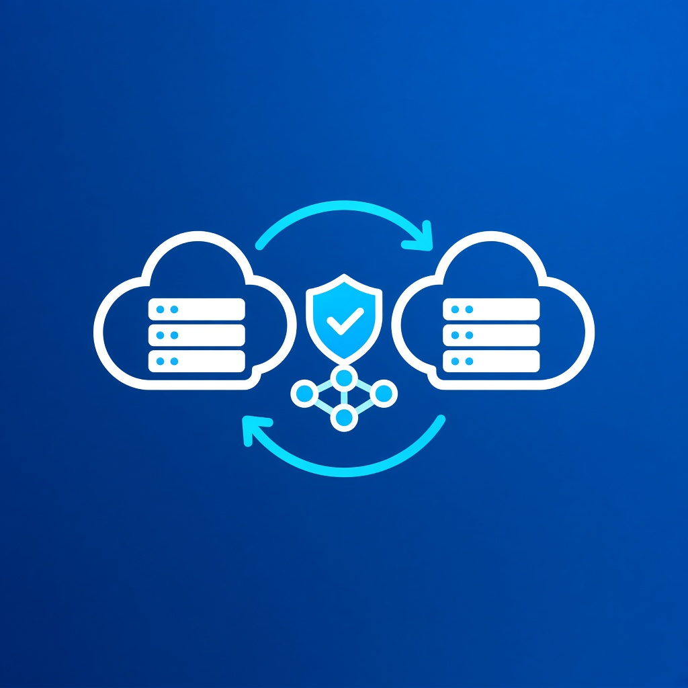
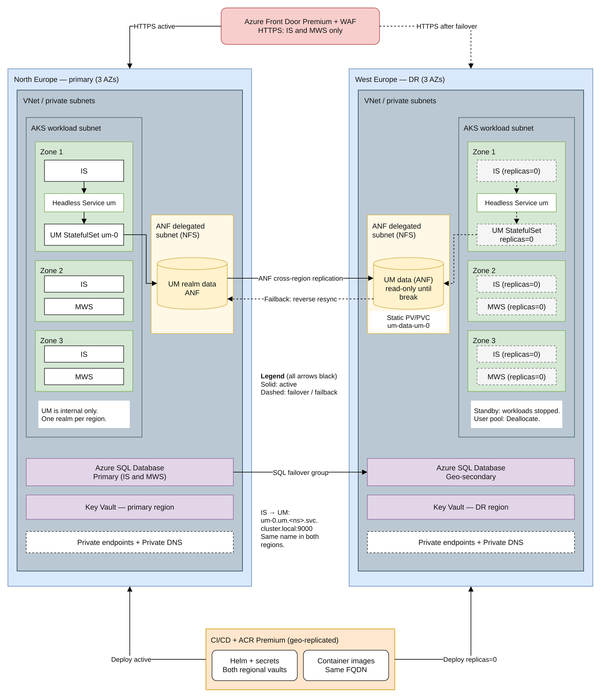

# Region variant B – Paired regions with zones in both (non-Australian)

Example: **North Europe** (Ireland, 3 zones) paired with **West Europe** (Netherlands, 3 zones). Equivalent pairs where both regions have zones include Japan East / Japan West, East US / West US, and Central US / East US 2. A pair with zones on only one side (Germany West Central / Germany North, UK South / UK West) behaves like the Australian variant. Source: [Azure regions list](https://learn.microsoft.com/en-us/azure/reliability/regions-list).

## What is specific to this variant

- AKS pools, Azure SQL Database (zone-redundant), and IS/MWS replicas use availability zones in **both** regions. UM is one realm per region on ANF: active in the serving region and stopped in standby.
- DR can run indefinitely. Failback becomes optional: you can run "swap primary" instead.
- The cost is the same as the Australian variant, apart from per-region price differences.
- In each region, IS reaches UM at `nsp://um-0.um.webmethods.svc.cluster.local:9000` (headless Service, single-replica StatefulSet). Front Door serves IS/MWS HTTPS only.
- UM DR volume handling is the same as the Australian variant: break ANF replication at failover (read-only → read-write), static PV/PVC `um-data-um-0` in DR, primary UM stopped while DR is active, reverse resync then planned switchback.

## How to choose the region pair

1. **Data residency and regulation** first. Both regions must be in an allowed geography.
2. **Availability zones in both regions**, if DR must survive a datacenter failure while active.
3. **Service availability in both regions** for every service in `azure-service-validation.xlsx`: ANF and its replication pair, Azure SQL Database zone redundancy, AKS VM families, Front Door Private Link origins.
4. **Paired vs non-paired.** A pair gives sequenced updates, Microsoft-managed replication for some services (Key Vault, GRS storage, AKS Backup cross-region restore) and physical separation. Non-paired regions are fine when every replication path in the design is customer-managed, which it is here, except for AKS Backup.
5. **Latency and distance.** Choose sufficient separation to reduce shared-disaster risk, then measure ANF transfer duration and SQL replication lag against the RPO targets.
6. **Capacity and price.** Confirm VM quota in the DR region for full production scale (see [AKS](https://learn.microsoft.com/en-us/azure/aks/scale-down-mode) and quota tools), and compare region pricing.
